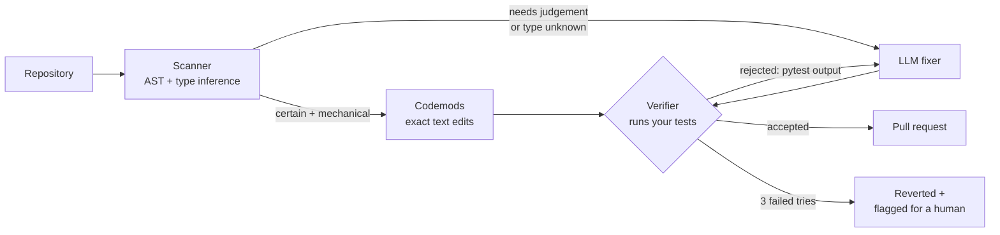

<div align="center">

# APIShift

**An agent that upgrades your code across breaking library changes, starting with pandas 1.x → 2.x.
It fixes what it can with exact rewrites, uses an LLM where judgement is needed, proves every change
by running your tests, and opens a pull request.**

[](https://github.com/vik-bit/apishift/actions/workflows/tests.yml)


[Why it's hard](#why-its-hard) · [Results](#results) · [How it works](#how-it-works) · [Use it](#use-it) ·
[System design](docs/SYSTEM_DESIGN.md) · [Rules](docs/RULES.md)

</div>

---

## At a glance

| | |
|---|---|
| **The problem** | pandas 2.0 deleted APIs that millions of scripts use (`df.append`, `iteritems`, `mad`, `lookup`, …). Find-and-replace gets the easy cases and silently breaks the hard ones. LLMs handle the hard ones but sometimes write code that doesn't run. |
| **What I built** | A static analyser with **dataflow type inference** that finds every removed API and tells `DataFrame.append` apart from `list.append`. **Codemods** at exact AST positions fix the mechanical cases. An **LLM fixer** handles the rest, and every change it makes has to **pass the project's own tests**; failures go back to the model with the pytest output. It ships as a CLI and a **GitHub Action that opens a PR**. |
| **Result (measured)** | On a 28-case benchmark with ground-truth tests: **APIShift fixed 25/25 (100%)**, vs **44%** for codemods alone and **96%** for the LLM alone, using **22% fewer tokens** than the LLM alone, and left all 3 "don't touch this" cases untouched. The one case only APIShift solved was caught by its test-feedback loop. [Details ↓](#results) |
| **Skills shown** | Compilers-style program analysis (AST, type lattice, inter-procedural inference) · LLM agents with verify-and-retry · test-driven verification · benchmark design with negative controls · GitHub automation · zero-dependency core |

---

## Why it's hard

The same method call needs different rewrites, and one look-alike must not be touched at all:

```python
orders = orders.append({"id": 7, "amount": 9.5}, ignore_index=True)   # a dict row
board  = board.append(player_series, ignore_index=True)               # a Series as a row
year   = q1.append([q2, q3, q4], ignore_index=True)                   # a list of frames
self.history.append("added")                                          # a list: leave it alone!
```

| Approach | What it does with these |
|---|---|
| Find-and-replace (`x.append(y)` → `pd.concat([x, y])`) | Crashes on the dict and on the list of frames, turns the Series row into a new column, and breaks `list.append` |
| LLM alone | Usually right, but nothing checks it |
| **APIShift** | Infers that `self.history` is a list and skips it. Sends the three pandas calls to the LLM with migration notes, then runs the tests, and anything that fails goes back with the error |

```diff
-        orders = orders.append({"id": 7, "amount": 9.5}, ignore_index=True)
+        orders = pd.concat([orders, pd.DataFrame([{"id": 7, "amount": 9.5}])], ignore_index=True)
```

---

## Results

A benchmark of **28 small projects** ([`bench/cases/`](bench/cases)). Each has old pandas code, tests
describing what it must do, and a hand-written reference fix. `apishift bench-check` proves every
case is fair: the tests **fail** on the old code and **pass** on the reference fix. CI re-checks
this on every push. Everything runs in **strict mode** (deprecation warnings count as failures), so a
fix must also be ready for pandas 3. **Negative cases** (`list.append`, a custom class with
`.append`, a file without pandas) count only if left completely untouched.

| Method | Cases fixed | Hard cases | Negatives left alone | LLM calls | Tokens |
|---|---|---|---|---|---|
| Codemods only (no AI) | 11/25 (44%) | 0/6 | 3/3 | 0 | 0 |
| LLM alone, one shot | 24/25 (96%) | 5/6 | 3/3 | 26 | 18.9k |
| **APIShift** (codemods → LLM → test-verified retries) | **25/25 (100%)** | **6/6** | **3/3** | **20** | **14.7k** |

<sub>LLM: `openai/gpt-oss-120b` on Groq. One run, 2026-10-25. Per-case table: [docs/EVAL_RESULTS.md](docs/EVAL_RESULTS.md).</sub>

**What the numbers show:**
- **Codemods alone stop at 44%.** Every case that needs judgement (a dict row, `lookup`, `groupby(axis=1)`) is out of reach for rules.
- **Codemods first makes the LLM cheaper**: 6 fewer LLM calls and 22% fewer tokens than sending everything to the model.
- **The verifier caught what the LLM missed.** On `01-append-dict-rows` the LLM wrote the textbook rewrite,
  `pd.concat([orders, pd.DataFrame([row])])`. It looks right, but because the loop starts from an empty
  DataFrame, pandas 2.2 raises a `FutureWarning`: this concat will produce different column dtypes in
  pandas 3. The test run showed the warning, the model got it back, and its second attempt built the
  rows first and created the frame once. A one-shot tool would have opened a PR that is correct today
  and changes behaviour after the next upgrade.
- **Honest caveat:** a strong model already gets 96% on small, single-file cases, so the verifier's
  main value is the **guarantee**. Every accepted change passed the tests, and anything that couldn't
  is reverted and labelled instead of shipped.

---

## How it works



**1. Scanner: type inference, like a compiler front end** ([`analysis/scanner.py`](apishift/analysis/scanner.py))
Python has no types at runtime, so the scanner infers them with a forward dataflow pass over each
scope, on a small lattice (`DataFrame`, `Series`, `Index`, `GroupBy`, `list`, `dict`, `str`, `unknown`, …):

```python
def load():                       # pass 1 learns: load() returns DataFrame
    return pd.read_csv("sales.csv")

class Report:
    def __init__(self):
        self.df = load()          # self.df: DataFrame (tracked per class)
        self.notes = []           # self.notes: list
    def add(self, row):
        for name, col in self.df.iteritems():   # flagged: col becomes Series
            print(col.mad())                      # flagged: Series.mad
        self.notes.append(row)                    # not flagged: it's a list
```

Unknown receivers of ambiguous methods (an unannotated parameter's `.append`) are reported as
*possible* and handed to the LLM with "leave it unless it's pandas". Output is plain text, JSON, or
**SARIF** for GitHub code-scanning annotations.

**2. Codemods** ([`fix/codemods.py`](apishift/fix/codemods.py))
Mechanical rules (`iteritems` → `items`, `line_terminator=` → `lineterminator=`, `squeeze=True` →
`.squeeze("columns")`, `fillna(method="ffill")` → `.ffill()`, `pd.np` → `np` + import, …) are
rewritten at exact AST positions. Comments and formatting outside the edited characters are never
touched, UTF-8 column offsets are handled, and overlapping fixes on one chained expression are applied
over successive passes.

**3. LLM fixer and verifier** ([`fix/llm_fixer.py`](apishift/fix/llm_fixer.py), [`fix/verifier.py`](apishift/fix/verifier.py))
The model sees the file with flagged lines marked, plus each rule's migration note. Its answer must
parse and must not reintroduce the API. Then the test suite runs in a throwaway copy. **Accept iff no
previously passing test fails and no remaining failure points inside the changed file.** Otherwise the
model gets the pytest excerpt and tries again (3 attempts max), and after that the file is reverted and
listed for a human.

**4. Pull request** ([`github/pr.py`](apishift/github/pr.py), [`action.yml`](action.yml))
The PR body lists every change (file, line, rule, codemod or LLM, attempts), tests before and after,
and anything left for a human. If the project has no tests, the PR says the changes are unverified.

Full write-up: [docs/SYSTEM_DESIGN.md](docs/SYSTEM_DESIGN.md).

---

## Use it

```bash
pip install "apishift[groq] @ git+https://github.com/vik-bit/apishift"
```

| Command | What it does |
|---|---|
| `apishift scan .` | List removed / deprecated pandas APIs (`--format sarif` for code scanning, `--fail-on-findings` for CI) |
| `apishift fix .` | Show verified fixes as a diff, without touching files |
| `apishift fix . --write` | Apply them |
| `apishift fix . --pr` | Commit on `apishift/pandas-2`, push, and open a pull request |
| `apishift fix . --no-llm` | Codemods only: free, offline, deterministic |
| `apishift eval` | Re-run the benchmark below |

Set `GROQ_API_KEY` (free tier at console.groq.com) or `ANTHROPIC_API_KEY`. Without either, APIShift
runs codemods only.

**As a GitHub Action**, it opens a PR in your repository weekly or on demand. Copy
[`examples/apishift-workflow.yml`](examples/apishift-workflow.yml) to `.github/workflows/`.

---

## Rules

18 rules: 12 for APIs **removed** in pandas 2.0 (each verified to raise on pandas 2.2.3) and 6 for
**deprecations** that warn on 2.2 and break on pandas 3. The full table, with the migration note for
each, is in [docs/RULES.md](docs/RULES.md), generated from [`apishift/rules.py`](apishift/rules.py).

---

## Project structure

```
apishift/
├── analysis/      scanner (type inference), import resolution, SARIF output
├── fix/           codemods, LLM providers, LLM fixer, verifier, orchestrator  ← start at orchestrator.py
├── github/pr.py   branch, commit, push, open or update the PR (gh or REST, stdlib only)
├── eval/          benchmark loader, fairness checker, scoring, report
├── rules.py       the rule catalogue (single source of truth)
└── cli.py
bench/cases/       28 cases: src/ (old code) · tests/ · solution/ (reference fix)
tests/             unit tests, including the full fix loop against a scripted LLM
action.yml         GitHub Action
```

---

## Limitations and next steps

- **Tests are the contract.** A change in code no test covers can be wrong without being caught;
  the PR says so when a project has no tests.
- **The benchmark is hand-written:** 28 small cases modelled on common real-world patterns. The next
  step is to run it on open-source repositories pinned to pandas < 2.
- **Next:** pandas 3 rules (Copy-on-Write and string-dtype changes), Jupyter notebooks, and more
  migrations on the same engine (Pydantic v1 → v2, SQLAlchemy 1.4 → 2.0).

---

<sub>MIT licensed.</sub>
