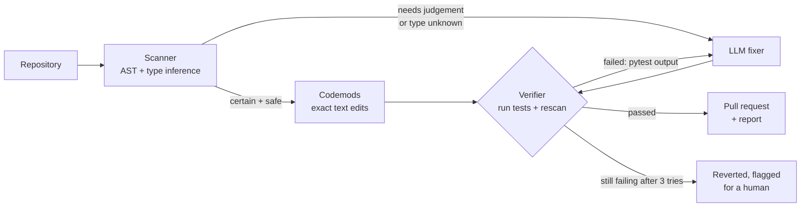

# APIShift: System Design

> **One line:** APIShift finds code that uses library APIs removed in a new version, fixes it with
> deterministic rewrites where it's safe and an LLM where judgement is needed, **proves every fix by
> running the project's own tests**, and opens a pull request.

The first supported migration is **pandas 1.x → 2.x**: 17 APIs that raise errors on pandas 2.2,
plus 6 deprecations that warn now and break in pandas 3. Each one was verified against a real
pandas 2.2.3 install (see §2).

Each section opens with a **plain-English** summary, followed by the **engineering detail**.

---

## 1. The problem

**Plain English.** Libraries change. When pandas 2.0 came out, it deleted functions millions of
scripts relied on, like `df.append(...)`. Upgrading means finding every use and rewriting it
correctly. "Correctly" is the hard part: `df.append({"a": 1}, ignore_index=True)` doesn't become
`pd.concat([df, {"a": 1}])`, because that crashes. It needs `pd.concat([df, pd.DataFrame([{"a": 1}])], ignore_index=True)`.

Find-and-replace tools get the easy cases right and silently break the hard ones. LLMs handle the
hard cases but sometimes invent code that doesn't work. **APIShift combines both and lets the test
suite decide.**

| | |
|---|---|
| Input | A Python repository with tests, plus a target library version |
| Output | A pull request whose changes pass the repository's tests, and a report of anything left for a human |
| Hard constraint | Never change code that isn't pandas. `list.append` must stay `list.append` |
| Success | Tests that failed because of the upgrade now pass, no previously passing test fails, and no removed API remains |

### Goals
1. **Detect** removed and deprecated API usage precisely, without flagging `.append` on lists.
2. **Fix** with the cheapest reliable method: deterministic rewrite first, LLM only when needed.
3. **Verify** every change by running the tests; feed failures back to the LLM to retry.
4. **Ship** as a pull request (CLI or GitHub Action) a reviewer can trust.
5. **Measure** on a benchmark with ground-truth tests, against a non-AI baseline.

### Non-goals
- Proving behaviour equivalence beyond what the tests cover. Tests are the contract; APIShift reports when there are none.
- Notebooks (`.ipynb`) and non-Python files in v1.

---

## 2. Rule catalogue (verified on pandas 2.2.3)

Each rule names the API, how it fails on pandas 2.2, and how APIShift fixes it.

| ID | Old API | On pandas 2.2 | Fix |
|---|---|---|---|
| PD001 | `DataFrame.append` / `Series.append` | AttributeError | **LLM** (shape of the argument decides the rewrite) |
| PD002 | `.iteritems()` | AttributeError | Codemod → `.items()` |
| PD003 | `.mad()` on DataFrame/Series | AttributeError | Codemod for simple receivers, else LLM |
| PD004 | `GroupBy.mad()` | AttributeError | **LLM** |
| PD005 | `DataFrame.lookup` | AttributeError | **LLM** |
| PD006 | `.is_monotonic` | AttributeError | Codemod → `.is_monotonic_increasing` |
| PD007 | `to_csv(line_terminator=)` | TypeError | Codemod → `lineterminator=` |
| PD008 | `read_csv(squeeze=True)` | TypeError | Codemod → `read_csv(...).squeeze("columns")` |
| PD009 | `set_axis(..., inplace=True)` | TypeError | **LLM** (statement becomes an assignment) |
| PD010 | `pd.Int64Index` / `Float64Index` / `UInt64Index` | AttributeError | Codemod → `pd.Index(..., dtype=...)` |
| PD011 | `pd.datetime` | AttributeError | Codemod → `datetime.datetime` (+ import) |
| PD012 | `pd.np` | AttributeError | Codemod → `np` (+ `import numpy as np`) |
| PD101 | `.applymap` | FutureWarning | Codemod → `.map` |
| PD102 | `.backfill()` / `.pad()` | FutureWarning | Codemod → `.bfill()` / `.ffill()` |
| PD103 | `.fillna(method="ffill"/"bfill")` | FutureWarning | Codemod → `.ffill()` / `.bfill()` |
| PD104 | `.swapaxes(...)` | FutureWarning | **LLM** |
| PD105 | `.groupby(..., axis=1)` | FutureWarning | **LLM** (`.T.groupby(...)` and transpose back) |
| PD106 | `pd.value_counts(x)` | FutureWarning | **LLM** |

The counts include variants. The rule table in `apishift/rules.py` is the single source of truth,
and `docs/RULES.md` is generated from it.

---

## 3. Architecture

**Plain English.** Four workers in a row:
- a **detective** reads the code and finds old API calls, working out whether `x` is a pandas
  table or a plain list before accusing it;
- a **mechanic** fixes the easy, unambiguous cases with exact rewrites;
- an **AI engineer** handles the cases that need judgement;
- an **inspector** runs the project's tests after every change and sends failed fixes back with the
  error message.

Only work that passes inspection goes into the pull request.



### 3.1 Scanner: `apishift/analysis/`

**Plain English.** Python doesn't say what type a variable is. Before calling `x.append(...)` a
pandas problem, the scanner works out what `x` holds, the way a compiler would.

**Detail.** The scanner parses with the stdlib `ast` module and runs a small **forward dataflow
type inference** over each scope:

- **Lattice:** `DataFrame`, `Series`, `Index`, `GroupBy`, `Pandas` (one of the above), `List`, `Dict`,
  `Str`, `Other`, `Unknown`.
- **Sources:** `pd.DataFrame(...)`, `pd.read_*(...)`, `pd.concat`, `pd.Series(...)`; list, dict and
  string literals; type annotations (`df: pd.DataFrame`); method calls on known frames
  (`df.copy()`, `df.merge(...)`, `df.groupby(...)`); subscripts (`df["col"]` is a Series,
  `df[["a", "b"]]` a DataFrame); loop targets (`for name, col in df.items()`); attribute assignments
  (`self.df = ...`, tracked by dotted name).
- **Inter-procedural (light):** a first pass records what each function in the module returns, so
  `df = load()` is typed when `load()` returns `pd.read_csv(...)`.
- **Import resolution:** handles `import pandas as pd`, `import pandas`, `from pandas import
  Int64Index`, and aliases.
- **Confidence:** a pandas-typed receiver is **certain**. `Unknown` (e.g. an unannotated parameter) is
  **possible**, so it's sent to the LLM with an explicit "leave it if this isn't pandas"
  instruction. `List`, `Dict` and `Str` are never flagged.

Output: `Finding(file, line, col, end, rule_id, receiver_kind, confidence, snippet)`, plus optional
SARIF 2.1.0 so findings can appear as GitHub code-scanning annotations.

### 3.2 Codemods: `apishift/fix/codemods.py`

**Plain English.** For mechanical renames, a precise text edit is safer and free; no AI needed.

**Detail.**
- Edits are computed from AST node positions and applied to the **original text**, so formatting
  and comments outside the edited span are untouched. AST column offsets are UTF-8 byte offsets,
  so they're converted per line to handle non-ASCII source correctly.
- Small renames replace only the attribute or keyword span (`iteritems` → `items`). Structural
  rewrites (`squeeze=True`, `fillna(method=)`, `Int64Index`) regenerate just that expression with
  `ast.unparse`.
- Imports are added when needed (`import numpy as np` for PD012), after the last top-level import,
  and only if the name isn't already bound.
- Edits are non-overlapping and applied in reverse order. Every result must re-parse, or the file
  is left untouched.

### 3.3 LLM fixer: `apishift/fix/llm_fixer.py`

**Plain English.** The AI gets the file, the flagged lines, and the official migration note for
each rule, and returns the updated file. If the tests then fail, it gets the error output and
tries again.

**Detail.**
- **Unit of work:** one file. Small files are sent whole, so the model sees imports and helpers.
  Flagged lines are marked inline (`# <<< APISHIFT PD001`).
- **Prompt contract:** minimal edits; keep behaviour identical to pandas 1.x semantics; leave
  non-pandas `.append` alone; return the complete file in one fenced `python` block. The markers
  must not appear in the output, and any that remain are stripped and reported.
- **Output gates (before tests run):** the code must parse; tests and other files are never
  touched (only the target file is written); and the rescan must show no remaining certain
  finding for the rules being fixed.
- **Retries:** up to 3 attempts. Each retry adds the trimmed pytest failure output and the
  previous attempt. If all fail, the file goes back to its codemod-only version and is flagged.
- **Providers:** Groq (open-weight models, default `openai/gpt-oss-120b`) and Claude (Anthropic)
  sit behind one `complete(system, user) -> text` interface. Text output with a fenced block,
  rather than tool calls, keeps the two providers identical and avoids malformed-JSON failures.

### 3.4 Verifier: `apishift/fix/verifier.py`

**Plain English.** The tests are the judge. A fix counts only if it doesn't break anything that
used to work and fixes what the upgrade broke.

**Detail.**
- The repo is copied once to a temporary workspace (skipping `.git`, virtualenvs and caches), and
  candidates are written there, never to the user's tree, until accepted.
- It runs `python -m pytest -q -rf -p no:cacheprovider` with a timeout. `--strict` adds
  `-W error::FutureWarning`, so deprecations count as failures.
- It parses failing test IDs. The baseline run (before any change) gives `before_failed`.
  **Accept iff** `after_failed ⊆ before_failed`, and either fewer tests fail or the rescan shows
  the targeted findings gone.
- Collection errors (an import-time `AttributeError`) are counted as failures of every test in that
  module, so they can't hide.

### 3.5 Pull requests: `apishift/github/pr.py` and `action.yml`

- **CLI:** `apishift fix . --pr` creates branch `apishift/pandas-2`, commits each accepted file,
  pushes, and opens a PR with `gh` (falling back to the REST API with `GITHUB_TOKEN`).
- **PR body:** a summary, a per-change table (file:line · rule · codemod or LLM · attempts), tests
  before and after, items left for a human, and links to the pandas migration notes.
- **GitHub Action** (`action.yml`, composite): installs the project, runs APIShift and opens the
  PR. Teams add one workflow file, with no server to host. A GitHub *App* would need hosting and
  key management for the same result; the Action gives the same pull request.

---

## 4. Evaluation

**Plain English.** I built a benchmark of small projects that break on pandas 2.2. Each one has
tests that pass when the code is fixed correctly, plus a hand-written correct solution proving the
tests are fair. Every method is scored on the same projects.

**Benchmark** (`bench/cases/`): each case has `src/` (old code), `tests/` (behaviour tests) and
`solution/` (a reference fix). `apishift bench-check` validates every case: tests must **fail** on
the original (except negative cases) and **pass** on the solution, both under pandas 2.2 with
`-W error::FutureWarning`. CI runs this check.

Cases cover each rule, harder variants (appending a dict, a Series row, a list of frames; `lookup`;
`groupby(axis=1)`), multi-rule files, inferred types across functions and methods, and **negative
cases** (`list.append`, a custom class with `.append`, unannotated parameters that are lists) where
the correct behaviour is to change nothing.

| Method | What it is |
|---|---|
| **Codemod only** (no AI) | Deterministic rules, plus a naive `x.append(y)` → `pd.concat([x, y])` rewrite: what a find-and-replace tool does |
| **LLM, one shot** | The LLM rewrites each flagged file once, with no test feedback |
| **APIShift** | Codemods, then the LLM, with test-verified retries |

**Metrics:** cases fully fixed (tests pass, nothing removed remains), negative cases left untouched,
LLM calls, tokens, wall time, and how many fixes needed a retry, which is the verifier's
measurable contribution.

---

## 5. Failure modes

| Risk | Mitigation |
|---|---|
| Changing `list.append` | Type inference skips lists, dicts and strings; unknown receivers go to the LLM with explicit instructions; negative cases in the benchmark |
| The LLM edits unrelated code or tests | Only the target file is written; tests are read-only; output must re-parse; minimal-edit instruction |
| The LLM fix passes because tests are weak | Reported honestly: the PR shows test coverage of changed lines as "verified by N tests"; changes with no covering tests are marked "unverified" |
| Tests fail for unrelated reasons before migration | Baseline run; accept on `after ⊆ before` |
| Slow or huge test suites | Timeout; `--test-cmd` override to run a subset |
| Code executed from an untrusted repo | Tests run in a temporary copy, in a subprocess with a timeout; for untrusted code, run inside the GitHub Action's disposable runner |
| Formatting churn | Text-span edits; whole-file LLM output is diffed and the PR shows the minimal diff |

---

## 6. Repository map

```
apishift/
├── apishift/
│   ├── rules.py            ← rule catalogue (single source of truth)
│   ├── analysis/           ← imports, type inference, scanner, SARIF output
│   ├── fix/                ← codemods, LLM providers, LLM fixer, verifier, orchestrator
│   ├── github/pr.py        ← branch, commit, push, open PR
│   ├── eval/               ← benchmark runner and report
│   └── cli.py              ← apishift scan | fix | bench-check | eval
├── bench/cases/            ← benchmark: src/ + tests/ + solution/ per case
├── action.yml              ← GitHub Action
├── docs/                   ← this file, rules table, evaluation results
└── tests/                  ← unit tests (inference, codemods, fixer loop with a fake LLM)
```
